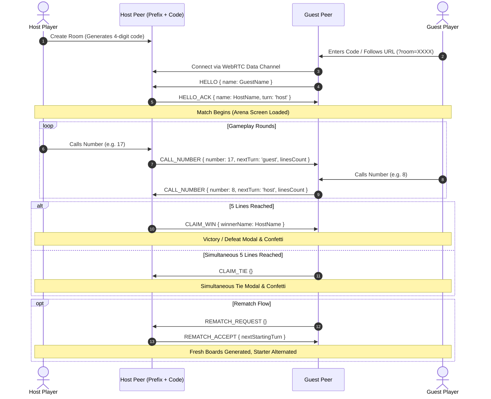

# BINGO // 25 — iOS Premium Edition
> A production-ready, zero-backend 1–25 Classic Multiplayer Bingo Web Application designed for mobile (`100dvh` iOS Safari first) with real-time peer-to-peer WebRTC connectivity via PeerJS, zero-asset Web Audio synthesis, and an intelligent AI practice bot.

[](https://bingo-web-app-nine.vercel.app)
[](https://react.dev/)
[](https://vitejs.dev/)
[](https://tailwindcss.com/)
[](https://peerjs.com/)

---

## 🌐 Live Deployment

* **Production URL:** [https://bingo-web-app-nine.vercel.app](https://bingo-web-app-nine.vercel.app)
* **Direct Invite Format:** `https://bingo-web-app-nine.vercel.app/?room=XXXX` (where `XXXX` is any 4-digit room code)

---

## 🌟 Overview & Key Highlights

* **Zero-Backend Architecture**: Operates 100% client-side in the browser. Requires zero database instances, no Firebase, no custom backend relay servers, and zero API keys.
* **Instant Serverless P2P Multiplayer**: Direct browser-to-browser WebRTC data channels via **PeerJS** using a deterministic 4-digit room code or shareable invite link (`?room=XXXX`).
* **iOS 18 Dark Obsidian Aesthetics**: Mobile-first design tailored for iPhone Safari:
  - Exact `100dvh` viewport locks and native PWA home-screen support (`apple-mobile-web-app-capable`).
  - Tactile 3D glass tiles with physical bottom lip, depressed called states, and radiant emerald completed-line glows.
  - Ambient radial background glow orbs (`#6366F1` Indigo & `#10B981` Emerald) for depth.
* **Zero-Asset Web Audio Synthesizer**: Pure Web Audio API oscillators mathematically synthesizing mechanical pops, woody opponent thocks, harmonic line chimes, triumphant arpeggio fanfares, and percussive shuffle ticks without external MP3/WAV files.
* **Smart AI Practice Bot**: Play solo anytime with a heuristic AI bot featuring a natural 650ms thinking delay and weighted line-progression scoring.
* **12-Line Win Detector & Simultaneous Tie Handling**: Evaluates all 5 rows, 5 columns, and 2 diagonals simultaneously; handles mutual 5-line completions gracefully with dual confetti celebrations.

---

## 🛠️ Complete Tech Stack & Architecture Details

| Layer | Technology | Version | Purpose & Implementation Details |
| :--- | :--- | :--- | :--- |
| **Frontend Framework** | **React** | `^19.2.8` | Declarative component state machine managing Lobby, Waiting Room, Arena, and Rematch flows (`useState`, `useEffect`, `useRef`, `useCallback`). |
| **DOM Renderer** | **React DOM** | `^19.2.8` | Client-side root rendering in React 19 `StrictMode`. |
| **Build Tool & Bundler** | **Vite** | `^8.3.0` | High-performance bundling and sub-second HMR via `@vitejs/plugin-react`. |
| **Styling & CSS** | **Tailwind CSS v4** | `^4.0.0` | Utility CSS engine configured via `@tailwindcss/vite` combined with custom Obsidian glassmorphism rules. |
| **P2P Multiplayer** | **PeerJS (WebRTC)**| `^1.5.5` | Decentralized WebRTC peer connections using deterministic room addressing (`bingo25-live-room-XXXX`). |
| **Animations & UI** | **Framer Motion** | `^14.3.0` | Fluid spring physics, modal transitions, and dynamic pulse animations for B-I-N-G-O letter badges. |
| **Icons** | **Lucide React** | `^1.59.0` | Accessible iconography (`Trophy`, `Shuffle`, `Share2`, `Copy`, `Volume2`, `Bot`, `Users`, `RefreshCw`, etc.). |
| **Celebrations** | **Canvas Confetti**| `^1.9.4` | Particle physics confetti burst effects upon achieving B-I-N-G-O or simultaneous ties. |
| **Audio Synthesis** | **Web Audio API** | Native | Zero-latency synthesis using `AudioContext`, gain nodes, and frequency ramps; lazy-initialized to satisfy iOS autoplay policies. |
| **Linter / QA** | **Oxlint** | `^1.81.0` | Fast static code analysis and quality verification. |

---

## 🎯 Core Features & Game Mechanics

### 1. Dual Play Modes
* **2-Player Live Multiplayer**:
  - Connect two devices anywhere in the world over WebRTC using a simple 4-digit code.
  - Native iOS Web Share API integration (`navigator.share`) with automatic clipboard copy fallback.
* **Solo vs Smart AI Bot**:
  - Practice offline or solo without needing a second player.
  - The AI maintains a hidden 5x5 board and computes optimal moves using a line-maximization heuristic with a natural 650ms thinking delay.

### 2. Pre-Game Board Customization
* **Fisher-Yates 1–25 Board Generator**: Randomizes numbers 1 through 25 with uniform distribution.
* **"Shuffle My Board" Control**: Before the first number of a match is called (`calledNumbers.length === 0`), players can reshuffle their grid layout freely. Once the first move is played, the board layout locks permanently.

### 3. Real-Time 12-Line Win Detector (`evaluateBoard`)
* Continuously evaluates all 12 potential winning lines:
  - **5 Horizontal Rows**: `[0..4]`, `[5..9]`, `[10..14]`, `[15..19]`, `[20..24]`
  - **5 Vertical Columns**: `[0,5,10,15,20]`, `[1,6,11,16,21]`, `[2,7,12,17,22]`, `[3,8,13,18,23]`, `[4,9,14,19,24]`
  - **2 Diagonals**: `[0,6,12,18,24]` (Main), `[4,8,12,16,20]` (Anti)
* Uses a `Set` for $O(1)$ constant-time tile checks.
* When `completedLinesCount >= 5`, the game concludes immediately with a **B-I-N-G-O** victory.

### 4. Simultaneous Tie Resolution
* If a called number grants both players their 5th line simultaneously:
  - Game recognizes a mutual win condition.
  - Dispatches `CLAIM_TIE` packet across the WebRTC data channel.
  - Both players receive the "SIMULTANEOUS TIE!" celebratory modal, fanfare audio, and dual confetti bursts.

### 5. Smart AI Practice Bot Heuristic (`getBestBotMove`)
* Evaluates all remaining uncalled numbers on the bot's board:
  - **Completes a Line**: `+1500` points
  - **Creates 4-in-a-row**: `+200` points
  - **Creates 3-in-a-row**: `+40` points
  - **Creates 2-in-a-row**: `+10` points
* Randomizes selection among ties to provide natural, non-repetitive gameplay.

---

## 🔊 Zero-Asset Synthesized Audio Engine (`src/utils/sound.js`)

All sound effects are synthesized via native mathematical oscillators, eliminating network asset requests and playback lag:

1. **`playTapSound()`** (Mechanical Tile Pop):
   - Waveform: `triangle`
   - Frequency: `520 Hz` ramping down exponentially to `180 Hz` over `0.08s` (gain `0.3` to `0.001`).
2. **`playOpponentTapSound()`** (Opponent Move Woody Thock):
   - Waveform: `sine`
   - Frequency: `340 Hz` ramping to `220 Hz` over `0.08s` (gain `0.32` to `0.001`).
3. **`playLineCompleteSound()`** (Line Completion Chime):
   - Waveform: `sine`
   - Harmonic two-note chime: Note 1 at `587.33 Hz` ($D_5$), Note 2 at `880.00 Hz` ($A_5$) staggered by `0.12s`.
4. **`playWinFanfare()`** (Triumphant 4-Note Arpeggio):
   - Overlapping arpeggio chord: $C_5$ (`523.25 Hz`) $\rightarrow$ $E_5$ (`659.25 Hz`) $\rightarrow$ $G_5$ (`783.99 Hz`) $\rightarrow$ $C_6$ (`1046.50 Hz`).
5. **`playShuffleSound()`** (Percussive Shuffle Tick):
   - Triple micro-click burst at `0s`, `0.04s`, and `0.08s` ramping `680 Hz` down to `260 Hz` in `30ms`.

---

## 📡 WebRTC Data Channel Protocol (`src/App.jsx`)

Rooms communicate peer-to-peer using deterministic room mapping: `const PEER_PREFIX = 'bingo25-live-room-';`.



---

## 📱 Mobile-First iOS Safari Ergonomics

* **Native PWA Ready**: Includes meta tags for full-screen display (`apple-mobile-web-app-capable`, `apple-mobile-web-app-status-bar-style: black-translucent`).
* **Viewport Lock**: Prevents pull-to-refresh, accidental bounce/elastic scrolling, and page zooming using `touch-action: manipulation;` and fixed positioning.
* **No Text Selection or Callouts**: Configured with `-webkit-touch-callout: none;` and `-webkit-user-select: none;`.
* **Zero Tap Gray Boxes**: Stripped default mobile highlight styling via `-webkit-tap-highlight-color: transparent;`.
* **Tabular Figures**: Utilizes `font-variant-numeric: tabular-nums` to eliminate number alignment jitter during gameplay.
* **Safe-Area Insets**: Proper padding supporting iPhone Dynamic Island, top notch, and home indicator bar.

---

## 📖 Step-by-Step Usage Guide

### A. How to Host a Multiplayer Game
1. Visit [https://bingo-web-app-nine.vercel.app](https://bingo-web-app-nine.vercel.app).
2. Enter your nickname.
3. Tap **"Create 2-Player Room"**.
4. A 4-digit room code is generated and displayed on the Waiting Room screen.
5. Tap **"Share Invite Link"** to send the direct link to a friend via iMessage/WhatsApp, or tap **"Copy Shareable URL"**.

### B. How to Join a Multiplayer Game
* **Via Invite Link**: Open the shared link (e.g., `https://bingo-web-app-nine.vercel.app/?room=1234`). The room code is automatically detected and populated. Tap **"Join"** to connect instantly.
* **Via 4-Digit Code**: On the lobby screen, type the 4-digit code provided by the host and tap **"Join"**.

### C. How to Install as an iOS Home-Screen App (PWA)
1. Open [https://bingo-web-app-nine.vercel.app](https://bingo-web-app-nine.vercel.app) in **Safari** on your iPhone.
2. Tap the **Share** button (box with an upward arrow) in the bottom toolbar.
3. Scroll down and tap **"Add to Home Screen"**.
4. Confirm by tapping **"Add"** in the top right.
5. Launch **BINGO // 25** directly from your Home Screen for a clean, full-screen standalone app experience without browser address bars!

---

## 💻 Local Development & Deployment

### Prerequisites
* **Node.js**: `v18.0.0` or higher
* **npm**: `v9.0.0` or higher

### Local Setup
```bash
# Clone or navigate to the project directory
git clone https://github.com/your-username/bingo-web-app.git
cd bingo-web-app

# Install dependencies
npm install

# Start development server with LAN host exposure
npm run dev -- --host
```

### Production Build & Preview
```bash
# Compile and optimize for production
npm run build

# Preview production build locally
npm run preview
```

### Deploying to Vercel
This project deploys seamlessly as a static Vite application on Vercel:
```bash
npm install -g vercel
vercel
```
Or connect the repository directly in the [Vercel Dashboard](https://vercel.com) with standard Vite presets (`dist` build output, `npm run build` command).

---

## 📄 License
This project is open-source under the [MIT License](LICENSE).
