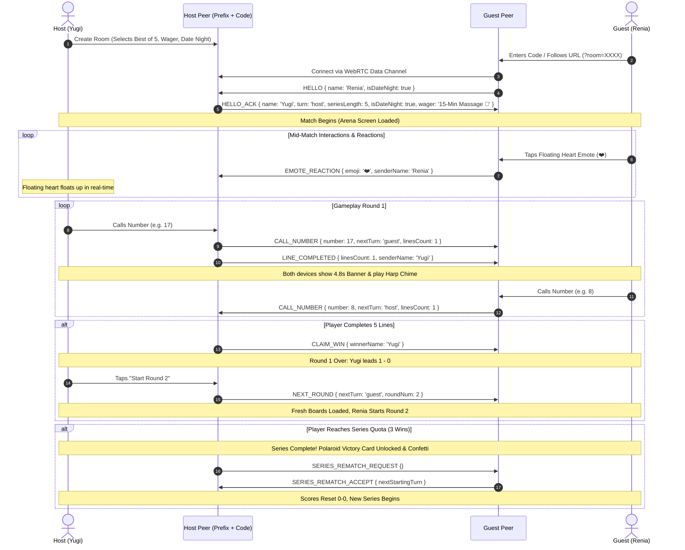

# BINGO // 25 — iOS Premium Edition
> A production-ready, zero-backend 1–25 Classic Multiplayer Bingo Web Application designed for mobile (`100dvh` iOS Safari first) with real-time peer-to-peer WebRTC connectivity via PeerJS, zero-asset Web Audio synthesis, Best-of Series match engine, exclusive Date Night Mode (Yugi & Renia), persistent head-to-head stats tracking, and an intelligent AI practice bot.

[](https://bingo-web-app-nine.vercel.app)
[](https://react.dev/)
[](https://vitejs.dev/)
[](https://tailwindcss.com/)
[](https://peerjs.com/)

---

## 🌐 Live Deployment

* **Production URL:** [https://bingo-web-app-nine.vercel.app](https://bingo-web-app-nine.vercel.app)
* **Direct Invite Format:** `https://bingo-web-app-nine.vercel.app/?room=XXXX` (where `XXXX` is any 4-digit room code)

---

## 🌟 Overview & Key Highlights

* **Zero-Backend Architecture**: Operates 100% client-side in the browser. Requires zero database instances, no Firebase, no custom backend relay servers, and zero API keys.
* **Instant Serverless P2P Multiplayer**: Direct browser-to-browser WebRTC data channels via **PeerJS** using a deterministic 4-digit room code or shareable invite link (`?room=XXXX`).
* **Best-of Series Match Engine**: Select from **Single Round**, **Best of 3**, **Best of 5**, **Best of 7**, or **Best of 10**. Real-time round win tracking, round transition modals, alternating starters, and grand series champion celebrations.
* **Exclusive "Date Night" Mode (Yugi & Renia)**: A dedicated romantic theme transforming the app with deep velvet rose surfaces, champagne gold accents (`#FBBF24`), heart icons, playful love banter banners, sweet crystalline harp audio chimes, and flying heart-burst confetti!
* **Persistent Head-to-Head Stats & Leaderboards (`localStorage`)**: Tracks lifetime series wins, individual round records, and win streaks for both players, viewable from the sleek lobby stats card.
* **iOS 18 Dark Obsidian Aesthetics**: Mobile-first design tailored for iPhone Safari:
  - Exact `100dvh` viewport locks and native PWA home-screen support (`apple-mobile-web-app-capable`).
  - Tactile 3D glass tiles with physical bottom lip, depressed called states, and radiant emerald or champagne-rose winning line glows.
  - Ambient radial background glow orbs (`#6366F1` Indigo & `#10B981` Emerald in Classic; `#F43F5E` Velvet Rose & `#FBBF24` Champagne Gold in Date Night).
* **Zero-Asset Web Audio Synthesizer**: Pure Web Audio API oscillators mathematically synthesizing mechanical pops, woody opponent thocks, harmonic line chimes, romantic harp chords, triumphant arpeggio fanfares, and percussive shuffle ticks without external MP3/WAV files.
* **Smart AI Practice Bot**: Play solo anytime with a heuristic AI bot featuring a natural 650ms thinking delay and weighted line-progression scoring.
* **12-Line Win Detector & Simultaneous Tie Handling**: Evaluates all 5 rows, 5 columns, and 2 diagonals simultaneously; handles mutual 5-line completions gracefully with dual confetti celebrations.

---

## 🛠️ Complete Tech Stack & Architecture Details

| Layer | Technology | Version | Purpose & Implementation Details |
| :--- | :--- | :--- | :--- |
| **Frontend Framework** | **React** | `^19.2.8` | Declarative component state machine managing Lobby, Waiting Room, Arena, Round Over, and Series Champion flows (`useState`, `useEffect`, `useRef`, `useCallback`). |
| **DOM Renderer** | **React DOM** | `^19.2.8` | Client-side root rendering in React 19 `StrictMode`. |
| **Build Tool & Bundler** | **Vite** | `^8.3.0` | High-performance bundling and sub-second HMR via `@vitejs/plugin-react`. |
| **Styling & CSS** | **Tailwind CSS v4** | `^4.0.0` | Utility CSS engine configured via `@tailwindcss/vite` combined with Obsidian and Date Night velvet rose styling. |
| **P2P Multiplayer** | **PeerJS (WebRTC)**| `^1.5.5` | Decentralized WebRTC peer connections using deterministic room addressing (`bingo25-live-room-XXXX`). |
| **Animations & UI** | **Framer Motion** | `^14.3.0` | Fluid spring physics, modal transitions, and dynamic pulse animations for B-I-N-G-O letter badges. |
| **Icons** | **Lucide React** | `^1.59.0` | Accessible iconography (`Trophy`, `Shuffle`, `Share2`, `Copy`, `Volume2`, `Bot`, `Users`, `RefreshCw`, `Heart`, `Flame`, `Swords`, etc.). |
| **Celebrations** | **Canvas Confetti**| `^1.9.4` | Particle physics confetti burst effects featuring custom SVG heart shapes (`shapeFromPath`) for Date Night and classic emerald-gold fireworks. |
| **Audio Synthesis** | **Web Audio API** | Native | Zero-latency synthesis using `AudioContext`, gain nodes, and frequency ramps; lazy-initialized to satisfy iOS autoplay policies. |
| **Linter / QA** | **Oxlint** | `^1.81.0` | Fast static code analysis and quality verification. |

---

## 🎯 Core Features & Game Mechanics

### 1. Best-of Series Match Engine
* **Flexible Series Formats**:
  - **Single Round**: 1 win needed
  - **Best of 3**: First to 2 wins takes the series
  - **Best of 5**: First to 3 wins takes the series
  - **Best of 7**: First to 4 wins takes the series
  - **Best of 10**: First to 6 wins takes the series
* **Round Progression & Transitions**:
  - Completing 5 lines completes the round and awards 1 point.
  - A **Round Winner Modal** displays the round score and series standing.
  - Tapping **"Start Next Round"** automatically generates fresh boards, clears called numbers, alternates who makes the opening move, and preserves the active WebRTC connection without re-dialing.
* **Grand Series Champion**:
  - When either player reaches the majority series quota (`targetWins`), the **Series Champion Modal** is triggered with confetti, fanfares, and persistent stats updates.

### 2. Exclusive "Date Night" Mode (Yugi & Renia)
* **One-Tap Romantic Mode Toggle**:
  - Prominent toggle in the lobby with a glowing heart (`❤️`).
  - Allows instant persona selection: **"Yugi 🥂"** or **"Renia 🌹"**.
  - In Solo Practice mode, dynamically inverts the opponent: playing as Yugi pairs you with **Renia (AI 💕)**; playing as Renia pairs you with **Yugi (AI 🥂)**.
* **Romantic Theme Overhaul**:
  - Surfaces shift from Obsidian black to deep velvet rose (`#12030C`).
  - Ambient glowing orbs shift to Rose (`#F43F5E`) and Champagne Gold (`#FBBF24`).
  - Called tiles feature deep rose gradients with `#FB7185` neon borders; winning line tiles glow in radiant champagne gold.
  - Heart badges (`❤️` & `💕`) prominently displayed next to player names and scores.
* **Date Night Wager & Stakes Engine**:
  - Select high-stakes romantic wagers directly in the lobby:
    - *15-Min Massage 💆*
    - *Chooses Tomorrow’s Dinner 🍕*
    - *Breakfast in Bed 🥞*
    - *Buys Morning Coffee ☕*
    - *Does the Dishes Tonight 🧼*
    - *Forehead Kisses on Demand 😘*
    - *Custom Wager Input* (create your own stakes on the fly!)
  - The agreed-upon wager is synced over WebRTC and displayed throughout the match and etched into the victory celebration.
* **Real-Time Floating Love Emote Reactions**:
  - In-game quick reaction bar with 5 expressive floating emotes: `❤️`, `😘`, `👀`, `🔥`, `🥺`.
  - Tapping an emote spawns a floating reaction with natural randomized drift and immediately dispatches an `EMOTE_REACTION` packet over WebRTC so it floats up on your partner's screen in real time!
* **Synchronized 4.8s Line Completion Notification**:
  - When either player completes a line, a prominent floating banner (`"Yugi claimed a line! ❤️"` or `"Renia claimed a line! 💕"`) stays visible for 4.8 seconds on both devices accompanied by a synchronized romantic harp chime, ensuring neither partner misses when the other is progressing.
* **Digital Polaroid Victory Memory Card**:
  - At the end of a Date Night series, players can open a nostalgic, retro **Digital Polaroid Memory Card** commemorating the match.
  - Displays the victor, winning score, date & time stamp, agreed-upon wager won, and a one-click **"Copy Love Note"** button formatted for iMessage / WhatsApp sharing.
* **Tactile Haptic Feedback**:
  - Integrated via `navigator.vibrate` with graceful safety checks for mobile devices.
  - Provides subtle tactile feedback on tile taps (15ms), harmonic double-pulses on line claims (`[25, 40, 25]`), and celebratory fanfare vibration patterns on victory (`[50, 60, 50, 60, 100]`).
* **Playful / Romantic Gender-Tailored Flavor Banners**:
  - When playing as Yugi: *"Waiting for Renia's sweet move... 💕"*, *"Make your lady proud, handsome! ✨"*, *"Renia claimed a line! ❤️"*.
  - When playing as Renia: *"Waiting for Yugi's genius move... ✨"*, *"Show him how it's done, gorgeous! 💖"*, *"Yugi claimed a line! 🥂"*.
* **Custom Flying Heart Confetti**:
  - Emits real flying heart particles using SVG heart path geometry with rose, fuchsia, and champagne gold palettes.

### 3. Persistent Head-to-Head Stats & Leaderboards (`localStorage`)
* Stored locally under key `bingo_h2h_stats_v2`:
  - **Lifetime Yugi vs. Renia Rivalry**: Dedicated series counters for both Yugi and Renia.
  - **Total Individual Rounds Won**: Cumulative rounds tally across all play sessions.
  - **Active Win Streak & Streak Holder**: Tracks current momentum (`🔥 3 in a row (Yugi)`).
* Includes a sleek rivalry card displayed right in the lobby with an instant "Reset" confirmation.

### 4. Real-Time 12-Line Win Detector (`evaluateBoard`)
* Continuously evaluates all 12 potential winning lines:
  - **5 Horizontal Rows**: `[0..4]`, `[5..9]`, `[10..14]`, `[15..19]`, `[20..24]`
  - **5 Vertical Columns**: `[0,5,10,15,20]`, `[1,6,11,16,21]`, `[2,7,12,17,22]`, `[3,8,13,18,23]`, `[4,9,14,19,24]`
  - **2 Diagonals**: `[0,6,12,18,24]` (Main), `[4,8,12,16,20]` (Anti)
* Uses a `Set` for $O(1)$ constant-time tile checks.
* When `completedLinesCount >= 5`, the round concludes immediately with a **B-I-N-G-O** victory.

### 5. Simultaneous Tie Resolution
* If a called number grants both players their 5th line simultaneously:
  - Game recognizes a mutual win condition.
  - Dispatches `CLAIM_TIE` packet across the WebRTC data channel.
  - Both players receive the "SIMULTANEOUS TIE!" celebratory modal, fanfare audio, and dual confetti bursts.

### 6. Smart AI Practice Bot Heuristic (`getBestBotMove`)
* Evaluates all remaining uncalled numbers on the bot's board:
  - **Completes a Line**: `+1500` points
  - **Creates 4-in-a-row**: `+200` points
  - **Creates 3-in-a-row**: `+40` points
  - **Creates 2-in-a-row**: `+10` points
* Randomizes selection among ties to provide natural, non-repetitive gameplay.

---

## 🔊 Zero-Asset Synthesized Audio Engine (`src/utils/sound.js`)

All sound effects are synthesized via native mathematical oscillators, eliminating network asset requests and playback lag:

1. **`playTapSound()`** (Mechanical Tile Pop):
   - Waveform: `triangle`
   - Frequency: `520 Hz` ramping down exponentially to `180 Hz` over `0.08s` (gain `0.3` to `0.001`).
2. **`playOpponentTapSound()`** (Opponent Move Woody Thock):
   - Waveform: `sine`
   - Frequency: `340 Hz` ramping to `220 Hz` over `0.08s` (gain `0.32` to `0.001`).
3. **`playLineCompleteSound()`** (Line Completion Chime):
   - Waveform: `sine`
   - Harmonic two-note chime: Note 1 at `587.33 Hz` ($D_5$), Note 2 at `880.00 Hz` ($A_5$) staggered by `0.12s`.
4. **`playRomanticChime()`** (Date Night Music-Box Harp Arpeggio):
   - Waveform: `sine`
   - Notes: $F\sharp_5$ (`739.99 Hz`), $A\sharp_5$ (`932.33 Hz`), $C\sharp_6$ (`1108.73 Hz`), $F_6$ (`1396.91 Hz`) with warm bell decays.
5. **`playWinFanfare()`** (Triumphant 4-Note Arpeggio):
   - Overlapping arpeggio chord: $C_5$ (`523.25 Hz`) $\rightarrow$ $E_5$ (`659.25 Hz`) $\rightarrow$ $G_5$ (`783.99 Hz`) $\rightarrow$ $C_6$ (`1046.50 Hz`).
6. **`playShuffleSound()`** (Percussive Shuffle Tick):
   - Triple micro-click burst at `0s`, `0.04s`, and `0.08s` ramping `680 Hz` down to `260 Hz` in `30ms`.

---

## 📡 WebRTC Data Channel Protocol (`src/App.jsx`)

Rooms communicate peer-to-peer using deterministic room mapping: `const PEER_PREFIX = 'bingo25-live-room-';`.



### WebRTC Packet Reference
| Packet Type | Direction | Payload Attributes | Description |
| :--- | :--- | :--- | :--- |
| `HELLO` | Guest $\rightarrow$ Host | `{ name, isDateNight }` | Initiates handshake and transmits guest nickname and theme state. |
| `HELLO_ACK` | Host $\rightarrow$ Guest | `{ name, turn, seriesLength, isDateNight, wager }` | Confirms connection, transmits host rules, turn order, and active wager. |
| `CALL_NUMBER` | Peer $\leftrightarrow$ Peer | `{ number, nextTurn, linesCount }` | Broadcasts called number (1–25) and passes active turn. |
| `LINE_COMPLETED`| Peer $\leftrightarrow$ Peer | `{ linesCount, senderName }` | Triggers synchronized 4.8s prominent banner and romantic chime. |
| `EMOTE_REACTION`| Peer $\leftrightarrow$ Peer | `{ emoji, senderName }` | Triggers floating physics reaction on partner's screen. |
| `CLAIM_WIN` | Peer $\leftrightarrow$ Peer | `{ winnerName }` | Broadcasts 5-line round victory and triggers celebration modal. |
| `CLAIM_TIE` | Peer $\leftrightarrow$ Peer | `{}` | Broadcasts simultaneous mutual 5-line tie. |
| `NEXT_ROUND` | Host $\rightarrow$ Guest | `{ nextTurn, roundNum }` | Synchronizes board resets and advances series round counter. |
| `SERIES_REMATCH_REQUEST` | Peer $\leftrightarrow$ Peer | `{}` | Requests reset for a fresh Best-of series. |
| `SERIES_REMATCH_ACCEPT` | Peer $\leftrightarrow$ Peer | `{ nextStartingTurn }` | Accepts series rematch and resets scores to 0–0. |

---

## 📱 Mobile-First iOS Safari Ergonomics

* **Native PWA Ready**: Includes meta tags for full-screen display (`apple-mobile-web-app-capable`, `apple-mobile-web-app-status-bar-style: black-translucent`).
* **Viewport Lock**: Prevents pull-to-refresh, accidental bounce/elastic scrolling, and page zooming using `touch-action: manipulation;` and fixed positioning.
* **No Text Selection or Callouts**: Configured with `-webkit-touch-callout: none;` and `-webkit-user-select: none;`.
* **Zero Tap Gray Boxes**: Stripped default mobile highlight styling via `-webkit-tap-highlight-color: transparent;`.
* **Tabular Figures**: Utilizes `font-variant-numeric: tabular-nums` to eliminate number alignment jitter during gameplay.
* **Safe-Area Insets**: Proper padding supporting iPhone Dynamic Island, top notch, and home indicator bar.

---

## 📖 Step-by-Step Usage Guide

### A. How to Host a Multiplayer Game
1. Visit [https://bingo-web-app-nine.vercel.app](https://bingo-web-app-nine.vercel.app).
2. Enter your nickname (or select **"I am Yugi 🥂"** / **"I am Renia 🌹"**).
3. Toggle **"Date Night Mode (Yugi & Renia)"** if playing with your partner.
4. Select your **Series Length** (Single, Best of 3, 5, 7, or 10).
5. Tap **"Create 2-Player Room"**.
6. Share the 4-digit room code or tap **"Share Invite Link"** to send via iMessage/WhatsApp.

### B. How to Join a Multiplayer Game
* **Via Invite Link**: Open the shared link (e.g., `https://bingo-web-app-nine.vercel.app/?room=1234`). The room code is automatically detected and populated. Tap **"Join"** to connect instantly.
* **Via 4-Digit Code**: On the lobby screen, type the 4-digit code provided by the host and tap **"Join"**.

### C. How to Install as an iOS Home-Screen App (PWA)
1. Open [https://bingo-web-app-nine.vercel.app](https://bingo-web-app-nine.vercel.app) in **Safari** on your iPhone.
2. Tap the **Share** button (box with an upward arrow) in the bottom toolbar.
3. Scroll down and tap **"Add to Home Screen"**.
4. Confirm by tapping **"Add"** in the top right.
5. Launch **BINGO // 25** directly from your Home Screen for a clean, full-screen standalone app experience without browser address bars!

---

## 💻 Local Development & Deployment

### Prerequisites
* **Node.js**: `v18.0.0` or higher
* **npm**: `v9.0.0` or higher

### Local Setup
```bash
# Clone or navigate to the project directory
git clone https://github.com/your-username/bingo-web-app.git
cd bingo-web-app

# Install dependencies
npm install

# Start development server with LAN host exposure
npm run dev -- --host
```

### Production Build & Preview
```bash
# Compile and optimize for production
npm run build

# Preview production build locally
npm run preview
```

### Deploying to Vercel
This project deploys seamlessly as a static Vite application on Vercel:
```bash
npm install -g vercel
vercel
```
Or connect the repository directly in the [Vercel Dashboard](https://vercel.com) with standard Vite presets (`dist` build output, `npm run build` command).

---

## 📄 License
This project is open-source under the [MIT License](LICENSE).
